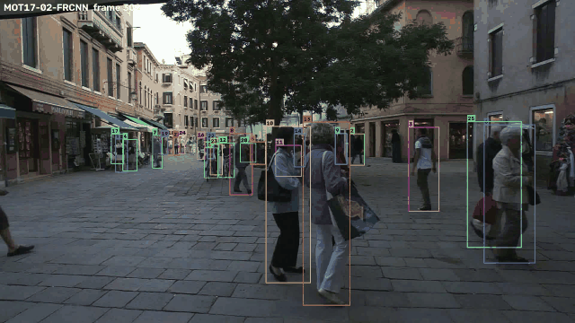

# Multicam Tracker

**Multi-camera people tracking with ground-plane fusion.** Multicam Tracker follows everyone in a scene
watched by several overlapping cameras. It gives each person one identity across every view and
shows where they are actually standing on a shared metric map.

The single-camera part is complete and evaluated on MOT17: fine-tuning YOLO11s on MOT17 raised
**HOTA from 44.3 to 53.3** and **IDF1 from 51.3 to 63.4** over the COCO-pretrained detector,
scored with official TrackEval.



*Fine-tuned YOLO11s + tracker on MOT17-02. Video from the
[MOTChallenge](https://motchallenge.net/) benchmark (CC BY-NC-SA 3.0).*

## What it does

```
            ┌ camera k (x7) ──────────────────────────────────────────────┐
  frames →  │ detect (YOLO) → foot point → ground plane (+ covariance)     │
            │               → re-ID embedding → local tracker (metres, KF) │
            └───────────────────────────────┬──────────────────────────────┘
                                            ↓ local tracks
                         cross-camera fusion: sticky links, per-camera matching,
                         constrained clustering, information-form Kalman update
                                            ↓
                          global identities on the ground plane → metrics / video
```

The tracker, the assignment solver, the camera geometry and the metrics are all written from
scratch and tested; they are not wrapped libraries.

## Design decisions

1. **Track in world coordinates, not pixels.** Foot points are projected onto the ground plane,
   and a constant-velocity Kalman filter runs in metres and seconds. The motion model is then
   physical, one model serves every camera, and gates are in metres. At WILDTRACK's 2 fps a
   walking person's box moves further than its own width between frames. IoU association falls
   apart there; ground-plane association does not (this is a regression test:
   `tests/test_tracker.py`, `tests/test_pipeline.py`).
2. **Propagate uncertainty from pixels to the ground.** A one-pixel foot error is centimetres
   near the camera and metres near the horizon. Each detection carries `J Σ Jᵀ` (J = Jacobian of
   the image→ground homography), so gating uses Mahalanobis distance and fusion weights
   confident views above distant ones.
3. **Two-stage association (ByteTrack).** Low-confidence detections get a second chance against
   unmatched tracks, which rescues partially occluded people instead of switching their IDs.
4. **Fuse tracks, not detections.** Cross-camera matching links camera-local *tracks* to global
   identities and keeps those links while they stay plausible. A single bad frame in one camera
   cannot corrupt a global ID, and no identity ever takes two observations from one camera.

## Results

Every number comes from a command in this repo (`MANUAL.md` explains each step) and is scored
with the official TrackEval.

**Detector fine-tuning, MOT17** (train on the first half of each sequence, evaluate tracking on the
second half of all 7 sequences)

| Detector | HOTA | MOTA | IDF1 |
|---|---:|---:|---:|
| YOLO11s, COCO-pretrained | 0.443 | 0.369 | 0.513 |
| YOLO11s, fine-tuned on MOT17 | **0.533** | **0.550** | **0.634** |

The fine-tuned detector reaches 0.84 mAP50 / 0.57 mAP50-95 on the held-out half.

**Low-confidence rescue fix.** The second matching pass scored boxes as `1 - IoU x confidence`,
so a 0.3-confidence box could never pass a 0.5 threshold even at perfect overlap. Using IoU alone
in that pass cut track fragmentations from 663 to 440 at the same HOTA. Identity switches rose
slightly (203 to 222), so ID switches at crossings are still open; see
[reports/mot17_occlusion.md](reports/mot17_occlusion.md).

**MOT17-02-FRCNN demo, single camera** (all 600 frames)

| Detector | HOTA | MOTA | IDF1 | IDSW |
|---|---:|---:|---:|---:|
| Supplied Faster R-CNN boxes | 0.348 | 0.319 | 0.400 | 55 |
| YOLO11s, COCO-pretrained | 0.317 | 0.241 | 0.348 | 33 |

The two rows use the same video and tracker. Only the source of the person boxes changes.

**Multi-camera (WILDTRACK) and re-ID (Market-1501).** The fusion, ground-plane and re-ID code is
written and tested on synthetic multi-camera scenes; the WILDTRACK ablation (`make wildtrack-ablate`)
and re-ID evaluation (`multicam-tracker eval-reid`) have not been run yet.

## Quick start

Run these from the project directory:

```bash
make setup          # create .venv and install packages using pip
make test           # run the test suite, including TrackEval
make smoke          # synthetic tracking demo; no dataset needed
```

`make setup` installs CUDA 12.6 PyTorch for the WSL/NVIDIA setup. The Makefile uses
`.venv/bin/python` directly, so you do not need to activate the environment for `make`.
Run `make help` to see the main commands.

Once MOT17 is extracted into `data/MOT17`:

```bash
make mot17-demo        # track one clip and save a preview under runs/mot17/demo
make mot17-demo-score  # evaluate the same clip with official TrackEval
make mot17-yolo-demo   # run YOLO on that same clip for a fair comparison
make mot17-yolo-demo-score
```

If you prefer ordinary Python commands, activate the environment first:

```bash
source .venv/bin/activate
python -m pip install -r requirements.txt
python -m pytest
python -m multicam_tracker run --config configs/mot17/demo.yaml
```

`requirements.txt` contains the external package list and installs the local project.
The small `pyproject.toml` defines how to install our code and create the `multicam-tracker`
command. No publishing or application distribution is required.
Then follow [MANUAL.md](MANUAL.md): datasets, calibration check, training, evaluation, ablations.

## Verification

- Over 200 tests: hand-derived geometry, Kalman and assignment cases, a hand-written Hungarian
  checked against SciPy, tracker behaviour (occlusion, low-score rescue, low frame rate,
  appearance after occlusion), fusion rules, and end-to-end pipelines on a synthetic scene.
- The MOTA / IDF1 / HOTA implementation is checked against the official TrackEval on randomised
  sequences and agrees exactly, per sequence and combined (`tests/test_trackeval_parity.py`).
- `multicam-tracker verify-calibration` checks a downloaded dataset's calibration and grid conventions
  against its own annotations before any number is trusted.

## Layout

```
src/multicam_tracker/
  geometry/   camera model, image<->ground, DLT + RANSAC homography, uncertainty propagation
  tracking/   Kalman filter (image / ground motion), Hungarian, costs, track lifecycle, tracker
  fusion/     cross-camera association and global identities
  reid/       Bag-of-Tricks re-ID: model, losses, PK sampler, training, Market-1501 evaluation
  detection/  YOLO, public and oracle detectors; detection / embedding caches
  data/       MOT17, WILDTRACK, MultiviewX, Market-1501 loaders; synthetic scenes; calibration check
  eval/       CLEAR MOT, IDF1, HOTA (TrackEval-exact), MODA / MODP
  pipeline/   end-to-end runners, evaluation glue, demo rendering
  viz/        overlays, bird's-eye map, composites, video / GIF
  deploy/     ONNX export and ONNX Runtime embedder
  tools/      YOLO dataset conversion, re-ID crops, ablation tables, benchmark, TrackEval bridge
configs/      YAML experiments (inheritance via _base_)
tests/        pytest suite
```

## References

ByteTrack (Zhang et al., ECCV 2022) · Bag of Tricks for re-ID (Luo et al., CVPRW 2019) ·
In Defense of the Triplet Loss (Hermans et al., 2017) · MVDet (Hou et al., ECCV 2020) ·
HOTA (Luiten et al., IJCV 2021) · WILDTRACK (Chavdarova et al., CVPR 2018) ·
MOTChallenge / MOT17 (Milan et al., 2016)
